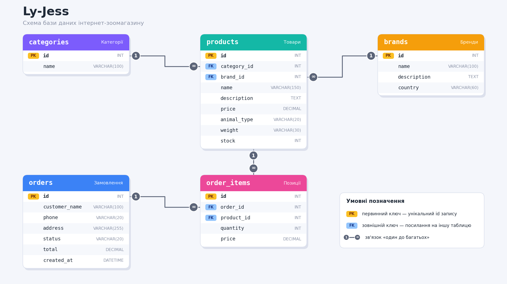

# Ly-Jess — інтернет-зоомагазин

## Про що цей сайт

Ly-Jess — це простий інтернет-магазин товарів для домашніх тварин: корми, ласощі, іграшки, лежаки, засоби догляду.

Ідея така: людина заходить на сайт, дивиться каталог, шукає товари за назвою, фільтрує за типом тварини, категорією, брендом і ціною, обирає потрібне та оформлює замовлення, вказавши своє ім'я, телефон і адресу.

## Що є на сайті

- **Категорії.** Корм, ласощі, іграшки, лежаки, догляд тощо.
- **Бренди.** Виробники товарів. На сторінці бренду видно всі його товари.
- **Товари.** У кожного є назва, опис, ціна, бренд, категорія, тип тварини (кіт, собака, гризун, птах, рибки), вага чи розмір та кількість на складі.
- **Замовлення.** Покупець обирає товари й кількість, залишає контакти. Замовлення має статус: нове, відправлене, доставлене або скасоване.
- **Адміністратор.** Додає, змінює й видаляє товари, бренди та категорії, а також змінює статуси замовлень.

> TODO: реєстрація, вхід, профіль з історією замовлень, кошик.

> TODO: замовлення (`/api/orders`) — описані нижче, але реалізовані будуть на наступному етапі.

> TODO: авторизація і права доступу (поки що всі ендпоінти відкриті).

> TODO: сторінка «Про нас» (контакти, доставка, повернення) — скоріше за все, це буде статична сторінка на клієнті.

---

## Як запустити проєкт

Потрібен Python 3.12+.

```bash
# 1. Клонувати репозиторій і перейти в папку проєкту
git clone <url-репозиторію>
cd REST-API-Design

# 2. Створити та активувати віртуальне середовище
python -m venv .venv
.venv\Scripts\activate          # Windows (PowerShell / cmd)
# source .venv/bin/activate      # macOS / Linux

# 3. Встановити залежності
pip install -r requirements.txt

# 4. Застосувати міграції (створить файл db.sqlite3)
python manage.py migrate

# 5. Запустити сервер
python manage.py runserver
```

API буде доступне за адресою **http://127.0.0.1:8000/api/** (наприклад, `http://127.0.0.1:8000/api/products`).

Додатково:

- `python manage.py createsuperuser` — створити адміністратора для `http://127.0.0.1:8000/admin/` (за потреби).
- `python manage.py test` — запустити автотести.

### CORS

Фронтенд працює на іншому порту, ніж API (бекенд — `8000`), тому на бекенді налаштовано CORS (`django-cors-headers`, налаштування `CORS_ALLOWED_ORIGINS` у `config/settings.py`). Дозволені origin-и: `http://localhost` і `http://127.0.0.1` на портах `3000`, `5173`, `5500`, `8080`. Якщо фронтенд запускається на іншому порту, додайте його в цей список.

### Postman

Колекція (Collection v2.1) лежить у `postman/Ly-Jess.postman_collection.json`.

1. Postman → **Import** → оберіть цей файл.
2. Базова адреса зберігається у змінній колекції `base_url` (за замовчуванням `http://127.0.0.1:8000/api`). Змінити її можна у вкладці **Variables** колекції.
3. Запустіть сервер і виконайте колекцію через **Run collection** (папки йдуть по порядку: id створених об'єктів підставляються автоматично).

У колекції є успішні запити й запити, що повертають помилки (мають префікс `[Помилка]`): 400 (невалідні дані), 404 (немає об'єкта) і 409 (видалення категорії/бренду, у яких є товари).

---

## REST API

Загальні правила:

- Дані передаються у форматі JSON (`Content-Type: application/json`).
- Префікс усіх адрес: `/api`. Адреси без `/` в кінці.
- Редагування: `PATCH` змінює лише передані поля, `PUT` вимагає всі поля об'єкта.
- Авторизації поки немає, усі ендпоінти відкриті.

### Формат помилок

Усі помилки на всіх ендпоінтах мають однаковий вигляд:

```json
{
  "error": "Зрозуміле повідомлення про те, що пішло не так",
  "details": { "name": ["Це поле обов'язкове."] }
}
```

Поле `error` є завжди. Поле `details` є лише в помилок валідації (`400`) і містить помилки по полях.

| Статус | Коли | Приклад `error` |
|---|---|---|
| `400 Bad Request` | невалідні дані, неправильні параметри каталогу, зламаний JSON | `Некоректні дані.` |
| `404 Not Found` | немає об'єкта з таким `id` або немає такого ендпоінта | `Категорію з id=999 не знайдено.` |
| `405 Method Not Allowed` | метод не підтримується ендпоінтом | `Метод "DELETE" не дозволений.` |
| `409 Conflict` | дані валідні, але дія суперечить бізнес-правилу | `Неможливо видалити категорію «Корм», оскільки в ній є товари: 3. Спочатку видаліть їх або перенесіть в іншу категорію.` |

**Чому `409`, а не `400`.** `400` означає, що сам запит неправильний (відсутнє поле, текст замість числа). Запит `DELETE /api/categories/1` синтаксично правильний, а проблема в поточному стані даних (у категорії є товари), тому це конфлікт `409`. Клієнт може повторити той самий запит після того, як видалить товари.

### Бізнес-правила

- Категорію не можна видалити, якщо в ній є товари (`409`).
- Бренд не можна видалити, якщо за ним закріплені товари (`409`).
- Назви категорій і брендів унікальні (`400` при дублікаті).
- Ціна товару більша за 0, кількість на складі не від'ємна, `animal_type` лише з дозволеного списку (`400`).
- Категорія і бренд товару мають існувати (`400`, якщо `category_id` чи `brand_id` не знайдено).

### Категорії

#### Список категорій

- **Навіщо:** показати меню категорій.
- **Метод:** `GET /api/categories`
- **Response:** `200 OK`. Список категорій, у кожної є `id` і `name`.

#### Одна категорія

- **Метод:** `GET /api/categories/{id}`
- **Response:** `200 OK`. Категорія з `id` і `name`.
- Якщо немає такої категорії: `404 Not Found`.

#### Створити категорію

- **Навіщо:** адміністратор додає нову категорію.
- **Метод:** `POST /api/categories`
- **Request body:** `name` (назва, унікальна).
- **Response:** `201 Created`. Створена категорія з `id` і `name`.
- Якщо немає назви або вона вже існує: `400 Bad Request`.

#### Змінити категорію

- **Навіщо:** адміністратор змінює назву категорії.
- **Метод:** `PATCH /api/categories/{id}` (або `PUT`)
- **Request body:** `name` (нова назва).
- **Response:** `200 OK`. Оновлена категорія.
- Якщо дані неправильні: `400 Bad Request`. Якщо немає такої категорії: `404 Not Found`.

#### Видалити категорію

- **Навіщо:** адміністратор прибирає непотрібну категорію.
- **Метод:** `DELETE /api/categories/{id}`
- **Response:** `204 No Content`.
- Якщо немає такої категорії: `404 Not Found`. Якщо в категорії є товари: `409 Conflict`.

#### Товари категорії

- **Навіщо:** сторінка категорії з усіма її товарами.
- **Метод:** `GET /api/categories/{id}/products`
- **Response:** `200 OK`. Список товарів категорії, у кожного є `id`, `name`, `price`, `animal_type`, `category_id`, `brand_id`.
- Якщо немає такої категорії: `404 Not Found`.

---

### Бренди

#### Список брендів

- **Навіщо:** сторінка з усіма брендами.
- **Метод:** `GET /api/brands`
- **Response:** `200 OK`. Список брендів, у кожного є `id` і `name`.

#### Один бренд

- **Навіщо:** сторінка бренду.
- **Метод:** `GET /api/brands/{id}`
- **Response:** `200 OK`. Бренд з полями `id`, `name`, `description`, `country`.
- Якщо немає: `404 Not Found`.

#### Товари бренду

- **Навіщо:** на сторінці бренду показати всі його товари.
- **Метод:** `GET /api/brands/{id}/products`
- **Response:** `200 OK`. Список товарів бренду, у кожного є `id`, `name`, `price`, `animal_type`, `category_id`, `brand_id`.
- Якщо немає такого бренду: `404 Not Found`.

#### Додати бренд

- **Навіщо:** адміністратор додає виробника.
- **Метод:** `POST /api/brands`
- **Request body:** `name` (обов'язково, унікальна), `description`, `country`.
- **Response:** `201 Created`. Створений бренд з `id`.
- Якщо немає назви або вона вже існує: `400 Bad Request`.

#### Змінити бренд

- **Навіщо:** адміністратор виправляє дані бренду.
- **Метод:** `PATCH /api/brands/{id}` (або `PUT`)
- **Request body:** будь-які з полів `name`, `description`, `country`.
- **Response:** `200 OK`. Оновлений бренд.
- Якщо дані неправильні: `400 Bad Request`. Якщо немає: `404 Not Found`.

#### Видалити бренд

- **Навіщо:** адміністратор прибирає бренд.
- **Метод:** `DELETE /api/brands/{id}`
- **Response:** `204 No Content`.
- Якщо немає: `404 Not Found`. Якщо у бренду є товари: `409 Conflict`.

---

### Товари

#### Список товарів

- **Навіщо:** каталог із пошуком, фільтрами та сортуванням.
- **Метод:** `GET /api/products`
- **Параметри (необов'язкові):**
  - `search` — пошук за назвою товару або назвою бренду (без урахування регістру)
  - `animal_type` — тип тварини: `cat`, `dog`, `rodent`, `bird`, `fish`
  - `category` — id категорії
  - `brand` — id бренду
  - `min_price` — мінімальна ціна
  - `max_price` — максимальна ціна
  - `sort` — сортування: `price_asc` (від найдешевших), `price_desc` (від найдорожчих). Без параметра товари йдуть за `id`.
- **Приклад:** `GET /api/products?animal_type=cat&category=1&max_price=500&sort=price_asc`
- **Response:** `200 OK`. Список товарів, у кожного є `id`, `name`, `price`, `animal_type`, `category_id`, `brand_id`.
- Якщо параметр неправильний (наприклад, невідомий `sort` або `min_price` більша за `max_price`): `400 Bad Request`.

> TODO: сортування `popular` (за популярністю) з'явиться разом із замовленнями — популярність рахуватиметься за кількістю проданих одиниць.

> TBD: пагінація каталогу (`page` і `limit`).

#### Один товар

- **Навіщо:** сторінка товару.
- **Метод:** `GET /api/products/{id}`
- **Response:** `200 OK`. Товар з полями `id`, `name`, `description`, `price`, `animal_type`, `weight`, `stock`, `category_id`, `brand_id`.
- Якщо немає: `404 Not Found`.

#### Додати товар

- **Навіщо:** адміністратор додає товар.
- **Метод:** `POST /api/products`
- **Request body:** `name`, `price`, `animal_type`, `category_id`, `brand_id` (обов'язкові); `description`, `weight`, `stock` (за замовчуванням `0`).
- **Response:** `201 Created`. Створений товар з `id`.
- Якщо дані неправильні або категорії чи бренду не існує: `400 Bad Request`.

#### Змінити товар

- **Навіщо:** змінити ціну, опис або кількість на складі.
- **Метод:** `PATCH /api/products/{id}` (або `PUT`)
- **Request body:** будь-які з полів товару (крім `id`).
- **Response:** `200 OK`. Оновлений товар.
- Якщо дані неправильні: `400 Bad Request`. Якщо немає: `404 Not Found`.

#### Видалити товар

- **Навіщо:** адміністратор прибирає товар з каталогу.
- **Метод:** `DELETE /api/products/{id}`
- **Response:** `204 No Content`.
- Якщо немає: `404 Not Found`.

---

### Замовлення

> Не реалізовано на цьому етапі (замовлення, кошик і авторизація заплановані на наступні етапи). Нижче — запланований дизайн API.


#### Створити замовлення

- **Навіщо:** покупець оформлює замовлення.
- **Метод:** `POST /api/orders`
- **Request body:**
  - `customer_name` — ім'я покупця
  - `phone` — телефон
  - `address` — адреса доставки
  - `items` — список товарів, у кожного є `product_id` і `quantity`
- **Response:** `201 Created`. Створене замовлення з `id`, `status` (спочатку `new`), `total` (загальна сума) і `customer_name`.
- Якщо список `items` порожній або товару немає на складі: `400 Bad Request`.

> TBD: оплата (спробувати тестове API LiqPay або взагалі поки зробити без оплати).

#### Список замовлень

- **Навіщо:** адміністратор бачить усі замовлення.
- **Метод:** `GET /api/orders`
- **Request body:** немає
- **Response:** `200 OK`. Список замовлень, у кожного є `id`, `status`, `total`, `customer_name`.

#### Одне замовлення

- **Навіщо:** подивитись деталі замовлення.
- **Метод:** `GET /api/orders/{id}`
- **Request body:** немає
- **Response:** `200 OK`. Замовлення з полями `id`, `status`, `total`, `customer_name`, `phone`, `address` і `items`. У кожного товару в `items` є `product_id`, `name`, `price`, `quantity`.
- Якщо немає: `404 Not Found`.

#### Змінити статус замовлення

- **Навіщо:** адміністратор відмічає, що замовлення відправлене чи доставлене, або скасовує його.
- **Метод:** `PATCH /api/orders/{id}`
- **Request body:** `status`. Можливі значення: `new`, `shipped`, `delivered`, `cancelled`.
- **Response:** `200 OK`. Оновлене замовлення.
- Якщо статус неправильний: `400 Bad Request`. Якщо замовлення немає: `404 Not Found`.

---

## Схема бази даних



Таблиці зі схеми:

| Таблиця | Поля |
|---|---|
| `categories` | `id` (PK), `name` |
| `brands` | `id` (PK), `name`, `description`, `country` |
| `products` | `id` (PK), `name`, `description`, `price`, `animal_type`, `weight`, `stock`, `category_id` (FK → categories), `brand_id` (FK → brands) |
| `orders` | `id` (PK), `customer_name`, `phone`, `address`, `status`, `total`, `created_at` |
| `order_items` | `id` (PK), `order_id` (FK → orders), `product_id` (FK → products), `quantity`, `price` (ціна на момент покупки) |

Зв'язки:

- одна категорія має багато товарів (1 → багато)
- один бренд має багато товарів (1 → багато)
- одне замовлення має багато позицій `order_items` (1 → багато)
- один товар може бути в багатьох позиціях замовлень (1 → багато)

Таким чином, між `orders` і `products` виходить зв'язок «багато до багатьох» через проміжну таблицю `order_items`.
