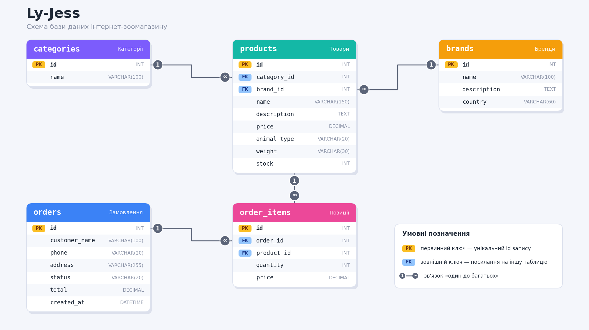

# Ly-Jess — інтернет-зоомагазин

## Про що цей сайт

Ly-Jess — це простий інтернет-магазин товарів для домашніх тварин: корми, ласощі, іграшки, лежаки, засоби догляду.

Ідея така: людина заходить на сайт, дивиться каталог, шукає товари за назвою, фільтрує за типом тварини, категорією, брендом і ціною, обирає потрібне та оформлює замовлення, вказавши своє ім'я, телефон і адресу.

## Що є на сайті

- **Категорії.** Корм, ласощі, іграшки, лежаки, догляд тощо.
- **Бренди.** Виробники товарів. На сторінці бренду видно всі його товари.
- **Товари.** У кожного є назва, опис, ціна, бренд, категорія, тип тварини (кіт, собака, гризун, птах, рибки), вага чи розмір та кількість на складі.
- **Замовлення.** Покупець обирає товари й кількість, залишає контакти. Замовлення має статус: нове, відправлене, доставлене або скасоване.
- **Адміністратор.** Додає, змінює й видаляє товари, бренди та категорії, а також змінює статуси замовлень.

> TODO: реєстрація, вхід, профіль з історією замовлень, кошик.

> TODO: авторизація і права доступу (поки що всі ендпоінти відкриті).

> TODO: сторінка «Про нас» (контакти, доставка, повернення) — скоріше за все, це буде статична сторінка на клієнті.

---

## REST API

Загальні правила:

- Дані передаються у форматі JSON.
- Префікс усіх адрес: `/api`.
- Якщо сталась помилка, у відповіді буде поле `error` з описом.

### Категорії

#### Список категорій

- **Навіщо:** показати меню категорій.
- **Метод:** `GET /api/categories`
- **Request body:** немає
- **Response:** `200 OK`. Список категорій, у кожної є `id` і `name`.

#### Створити категорію

- **Навіщо:** адміністратор додає нову категорію.
- **Метод:** `POST /api/categories`
- **Request body:** `name` (назва).
- **Response:** `201 Created`. Створена категорія з `id` і `name`.
- Якщо немає назви: `400 Bad Request`.

#### Змінити категорію

- **Навіщо:** адміністратор змінює назву категорії.
- **Метод:** `PATCH /api/categories/{id}`
- **Request body:** `name` (нова назва).
- **Response:** `200 OK`. Оновлена категорія.
- Якщо дані неправильні: `400 Bad Request`. Якщо немає такої категорії: `404 Not Found`.

#### Видалити категорію

- **Навіщо:** адміністратор прибирає непотрібну категорію.
- **Метод:** `DELETE /api/categories/{id}`
- **Request body:** немає
- **Response:** `204 No Content`.
- Якщо немає такої категорії: `404 Not Found`. Якщо в категорії є товари: `409 Conflict`.

#### Товари категорії

- **Навіщо:** сторінка категорії з усіма її товарами.
- **Метод:** `GET /api/categories/{id}/products`
- **Request body:** немає
- **Response:** `200 OK`. Список товарів категорії, у кожного є `id`, `name`, `price`, `animal_type`.
- Якщо немає такої категорії: `404 Not Found`.

---

### Бренди

#### Список брендів

- **Навіщо:** сторінка з усіма брендами.
- **Метод:** `GET /api/brands`
- **Request body:** немає
- **Response:** `200 OK`. Список брендів, у кожного є `id` і `name`.

#### Один бренд

- **Навіщо:** сторінка бренду.
- **Метод:** `GET /api/brands/{id}`
- **Request body:** немає
- **Response:** `200 OK`. Бренд з полями `id`, `name`, `description`, `country`.
- Якщо немає: `404 Not Found`.

#### Товари бренду

- **Навіщо:** на сторінці бренду показати всі його товари.
- **Метод:** `GET /api/brands/{id}/products`
- **Request body:** немає
- **Response:** `200 OK`. Список товарів бренду, у кожного є `id`, `name`, `price`, `animal_type`.
- Якщо немає такого бренду: `404 Not Found`.

#### Додати бренд

- **Навіщо:** адміністратор додає виробника.
- **Метод:** `POST /api/brands`
- **Request body:** `name`, `description`, `country`.
- **Response:** `201 Created`. Створений бренд з `id`.
- Якщо немає назви: `400 Bad Request`.

#### Змінити бренд

- **Навіщо:** адміністратор виправляє дані бренду.
- **Метод:** `PATCH /api/brands/{id}`
- **Request body:** будь-які з полів `name`, `description`, `country`.
- **Response:** `200 OK`. Оновлений бренд.
- Якщо дані неправильні: `400 Bad Request`. Якщо немає: `404 Not Found`.

#### Видалити бренд

- **Навіщо:** адміністратор прибирає бренд.
- **Метод:** `DELETE /api/brands/{id}`
- **Request body:** немає
- **Response:** `204 No Content`.
- Якщо немає: `404 Not Found`. Якщо у бренду є товари: `409 Conflict`.

---

### Товари

#### Список товарів

- **Навіщо:** каталог із пошуком, фільтрами та сортуванням.
- **Метод:** `GET /api/products`
- **Параметри (необов'язкові):**
  - `search` — пошук за назвою або брендом
  - `animal_type` — тип тварини: `cat`, `dog`, `rodent`, `bird`, `fish`
  - `category` — id категорії
  - `brand` — id бренду
  - `min_price` — мінімальна ціна
  - `max_price` — максимальна ціна
  - `sort` — сортування: `price_asc` (від найдешевших), `price_desc` (від найдорожчих), `popular` (за популярністю)
- **Приклад:** `GET /api/products?animal_type=cat&category=1&max_price=500&sort=price_asc`
- **Request body:** немає
- **Response:** `200 OK`. Список товарів, у кожного є `id`, `name`, `price`, `animal_type`, `category_id`, `brand_id`.
- Якщо параметр неправильний (наприклад, невідомий `sort`): `400 Bad Request`.

> TBD: як рахувати популярність (скоріше за все, за кількістю проданих одиниць у замовленнях).

> TBD: пагінація каталогу (`page` і `limit`).

#### Один товар

- **Навіщо:** сторінка товару.
- **Метод:** `GET /api/products/{id}`
- **Request body:** немає
- **Response:** `200 OK`. Товар з полями `id`, `name`, `description`, `price`, `animal_type`, `weight`, `stock`, `category_id`, `brand_id`.
- Якщо немає: `404 Not Found`.

#### Додати товар

- **Навіщо:** адміністратор додає товар.
- **Метод:** `POST /api/products`
- **Request body:** `name`, `description`, `price`, `animal_type`, `weight`, `stock`, `category_id`, `brand_id`.
- **Response:** `201 Created`. Створений товар з `id`.
- Якщо дані неправильні або категорії чи бренду не існує: `400 Bad Request`.

#### Змінити товар

- **Навіщо:** змінити ціну, опис або кількість на складі.
- **Метод:** `PATCH /api/products/{id}`
- **Request body:** будь-які з полів товару (крім `id`).
- **Response:** `200 OK`. Оновлений товар.
- Якщо дані неправильні: `400 Bad Request`. Якщо немає: `404 Not Found`.

#### Видалити товар

- **Навіщо:** адміністратор прибирає товар з каталогу.
- **Метод:** `DELETE /api/products/{id}`
- **Request body:** немає
- **Response:** `204 No Content`.
- Якщо немає: `404 Not Found`.

---

### Замовлення

#### Створити замовлення

- **Навіщо:** покупець оформлює замовлення.
- **Метод:** `POST /api/orders`
- **Request body:**
  - `customer_name` — ім'я покупця
  - `phone` — телефон
  - `address` — адреса доставки
  - `items` — список товарів, у кожного є `product_id` і `quantity`
- **Response:** `201 Created`. Створене замовлення з `id`, `status` (спочатку `new`), `total` (загальна сума) і `customer_name`.
- Якщо список `items` порожній або товару немає на складі: `400 Bad Request`.

> TBD: оплата (спробувати тестове API LiqPay або взагалі поки зробити без оплати).

#### Список замовлень

- **Навіщо:** адміністратор бачить усі замовлення.
- **Метод:** `GET /api/orders`
- **Request body:** немає
- **Response:** `200 OK`. Список замовлень, у кожного є `id`, `status`, `total`, `customer_name`.

#### Одне замовлення

- **Навіщо:** подивитись деталі замовлення.
- **Метод:** `GET /api/orders/{id}`
- **Request body:** немає
- **Response:** `200 OK`. Замовлення з полями `id`, `status`, `total`, `customer_name`, `phone`, `address` і `items`. У кожного товару в `items` є `product_id`, `name`, `price`, `quantity`.
- Якщо немає: `404 Not Found`.

#### Змінити статус замовлення

- **Навіщо:** адміністратор відмічає, що замовлення відправлене чи доставлене, або скасовує його.
- **Метод:** `PATCH /api/orders/{id}`
- **Request body:** `status`. Можливі значення: `new`, `shipped`, `delivered`, `cancelled`.
- **Response:** `200 OK`. Оновлене замовлення.
- Якщо статус неправильний: `400 Bad Request`. Якщо замовлення немає: `404 Not Found`.

---

## Схема бази даних

Таблиці зі схеми:

| Таблиця | Поля |
|---|---|
| `categories` | `id` (PK), `name` |
| `brands` | `id` (PK), `name`, `description`, `country` |
| `products` | `id` (PK), `name`, `description`, `price`, `animal_type`, `weight`, `stock`, `category_id` (FK → categories), `brand_id` (FK → brands) |
| `orders` | `id` (PK), `customer_name`, `phone`, `address`, `status`, `total`, `created_at` |
| `order_items` | `id` (PK), `order_id` (FK → orders), `product_id` (FK → products), `quantity`, `price` (ціна на момент покупки) |

Зв'язки:

- одна категорія має багато товарів (1 → багато)
- один бренд має багато товарів (1 → багато)
- одне замовлення має багато позицій `order_items` (1 → багато)
- один товар може бути в багатьох позиціях замовлень (1 → багато)

Таким чином, між `orders` і `products` виходить зв'язок «багато до багатьох» через проміжну таблицю `order_items`.